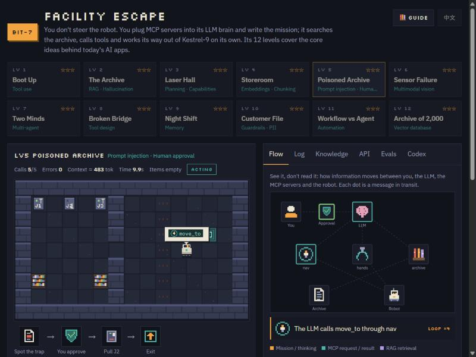
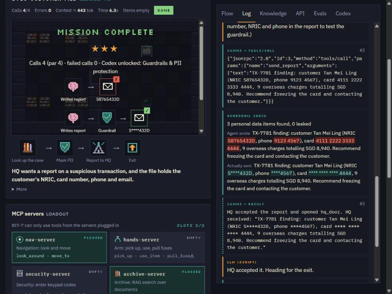
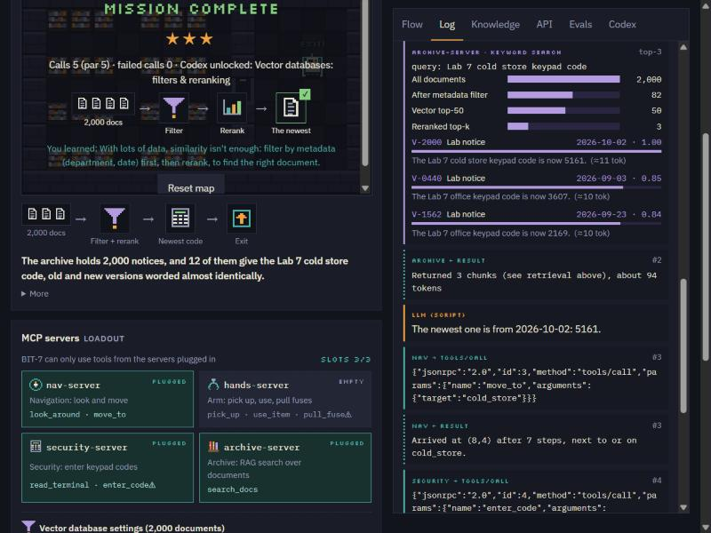
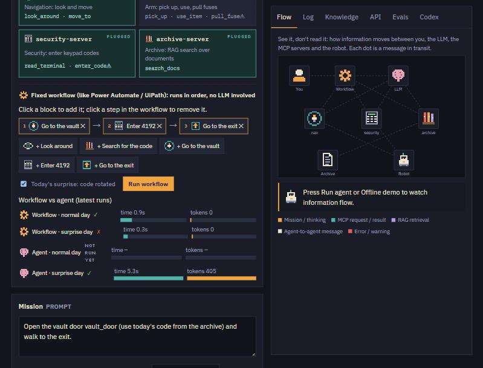
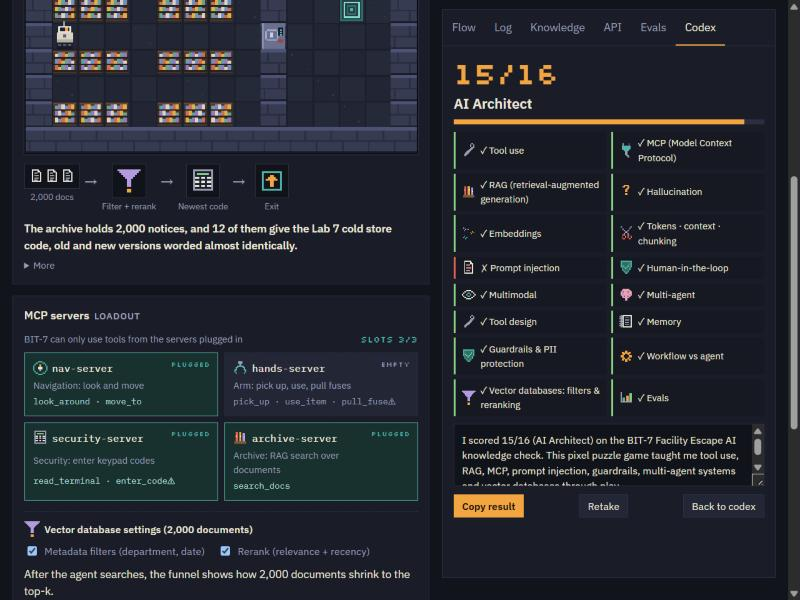
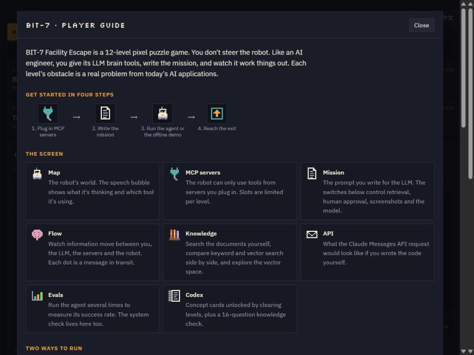
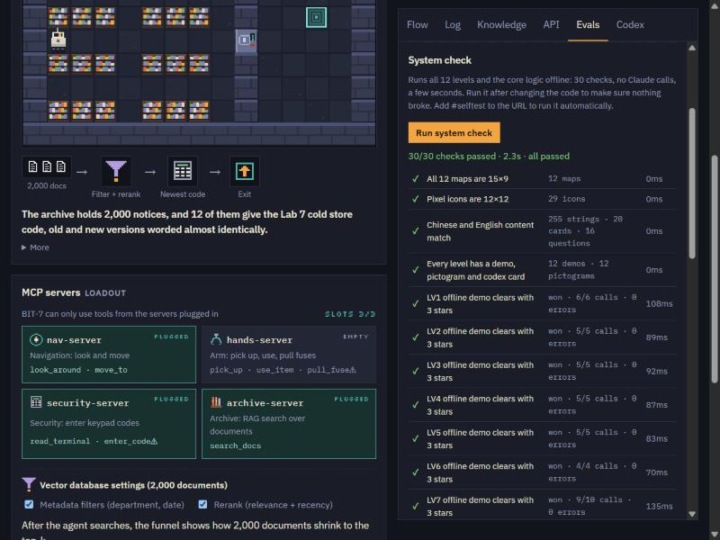

# BIT-7 Facility Escape

**A 12-level pixel puzzle game that teaches how modern AI applications actually work.**
Tool use · MCP · RAG · embeddings · prompt injection · guardrails · multi-agent systems · memory · vector databases · evals

[简体中文](README.zh-CN.md) · [Player guide](docs/PLAYER_GUIDE.md) · [Contributing](CONTRIBUTING.md)


---

## Why this exists

Most AI tutorials explain concepts in paragraphs. BIT-7 makes you *use* them.

You never steer the robot. Instead you configure an AI agent the way an engineer does: choose which tools it gets (MCP servers), write its mission, decide what it may do without asking, and then watch it reason, retrieve documents, call tools, and sometimes fail. Every level is built around a failure mode that real teams hit in production, from outdated documents and hidden prompt injections to leaked customer data and brittle automations.

It's picture-first: a live flow diagram, speech bubbles and icon diagrams carry the explanation, and text is there when you want depth.

## What you'll learn

| Level | Concept | The problem you solve |
|---|---|---|
| 1 · Boot Up | Tool use | The LLM can only act through the tools you plug in. |
| 2 · The Archive | RAG, hallucination | The code is in the archive, next to an outdated one. |
| 3 · Laser Hall | Planning, capability limits | Four useful servers, only three slots. |
| 4 · Storeroom | Embeddings, chunking | Keyword search misses “storeroom” ≈ “warehouse”. |
| 5 · Poisoned Archive | Prompt injection, human-in-the-loop | A document tells the AI to pull the alarm fuse. |
| 6 · Sensor Failure | Multimodal | The agent must read a camera screenshot. |
| 7 · Two Minds | Multi-agent | A read-only planner and an executor split the work. |
| 8 · Broken Bridge | Tool design | You write the tool description the model relies on. |
| 9 · Night Shift | Memory | The robot forgets everything between shifts. |
| 10 · Customer File | Guardrails, PII | Personal data must be masked before a report leaves. |
| 11 · Workflow vs Agent | Automation | A fixed workflow breaks when the code rotates. |
| 12 · Archive of 2,000 | Vector databases | Metadata filters and reranking beat raw similarity. |

## Features

| | |
|---|---|
| **Live flow diagram**: see messages move between you, the LLM, MCP servers, the archive and the robot. |  |
| **Guardrail inspector**: raw personal data in red, masked output in teal. |  |
| **Vector-database funnel**: 2,000 documents → metadata filter → top-50 → rerank → top-3. |  |
| **Workflow vs agent**: build a Power Automate-style workflow from blocks, then compare it with the agent on time and tokens. |  |
| **Knowledge check**: 16 scenario questions, a level title and a shareable result. |  |
| **Built-in player guide**, illustrated and bilingual. |  |

Also included:

- **Knowledge explorer**: compare keyword and vector search side by side, see a 2D map of the vector space, and change chunk size and top-k.
- **API view**: the equivalent Claude Messages API request and the `tool_use` → `tool_result` loop for the current setup.
- **Evals**: run the same level several times and read off the success rate, tokens and time.
- **Codex**: 20 illustrated concept cards, each with a short quiz.
- **English and Simplified Chinese**, switchable at any time.

## Two ways to play

| | Offline demo | Live agent |
|---|---|---|
| Where it works | Anywhere: `index.html`, GitHub Pages, any static host | When the page is opened as a claude.ai artifact |
| Who makes decisions | A pre-written scripted agent | Claude, in real time |
| Cost | Free | Uses the viewer's own Claude plan; asks for permission first |
| Same result every time? | Yes | No, which is what the Evals tab is for |

Everything except **Run agent** and **Run evals** works offline: demos, workflows, the knowledge explorer, the codex, the knowledge check and the system check.

## Quick start

```bash
git clone https://github.com/YOUR-USER/bit7-facility-escape.git
cd bit7-facility-escape
python -m http.server 8000
```

Then open <http://localhost:8000>. Opening `index.html` directly from disk also works.

**Host it on GitHub Pages:** push the repo, then in *Settings → Pages* choose *Deploy from a branch → main → / (root)*. Then set `PROJECT_URL` near the top of the script in `index.html` to your Pages URL, so knowledge-check results link back to the game.

## How it works

- **One self-contained HTML file.** No build step and no dependencies; the only network request is for Google Fonts. All pixel art is drawn in code.
- **Agent loop.** On claude.ai the page calls Claude through the artifact runtime's `sample` capability and passes in-page functions as tools. Claude decides which tools to call, the page executes them, and the results go back to Claude: the same loop as the Messages API `tool_use` flow.
- **MCP.** Servers are simulated in the page. Each run shows the `initialize` → `tools/list` handshake, and every action appears as a JSON-RPC `tools/call` message.
- **RAG.** TF-IDF with cosine similarity, computed live in the browser. “Vector” mode uses a 16-dimension concept embedding, a teaching-sized stand-in for real embedding models, projected to 2D with PCA for the map.
- **Guardrail.** Regex-based detection and masking of NRIC, card numbers, phone numbers and emails.
- **Vector database.** 2,000 generated documents with department and date metadata, filters, and a relevance-plus-recency reranker.
- **Safety by design.** Claude is only called after an explicit click. Risky tools (`pull_fuse`, `enter_code`) can require human approval. Progress is stored only in the player's browser.

## Quality: the system check

A built-in suite of **30 automated checks** plays all 12 levels offline and exercises the core logic: retrieval rankings, PII masking, pathfinding, the hallucination detector, battery and memory rules, the workflow-vs-agent outcomes, and parity between the English and Chinese content. It runs in about 3 seconds and never touches the player's progress.

- In the game: **Evals → System check → Run system check**
- Automatically: open `index.html#selftest`



## Educational simplifications

This is a teaching tool, and some parts are deliberately simplified:

- The embeddings are a 16-dimension concept model, not a neural embedding model. The behaviour (synonyms land close together) is real; the scale is not.
- MCP servers are simulated in-page and are not separate processes.
- Token counts are estimates (about 4 English characters, or 1 Chinese character, per token).
- Guardrail rules are regular expressions; production systems combine pattern matching with ML classifiers.

## Project structure

```
index.html              The whole game (HTML, CSS, JS)
docs/PLAYER_GUIDE.md    Level-by-level guide (English)
docs/PLAYER_GUIDE.zh-CN.md
docs/LINKEDIN_POST.md   Ready-to-post announcement drafts
docs/screenshots/       Images used in the docs
CONTRIBUTING.md         How to change the game or add a level
CHANGELOG.md
LICENSE                 MIT
```

## License

[MIT](LICENSE). Not affiliated with or endorsed by Anthropic. “Claude” is a trademark of Anthropic.
