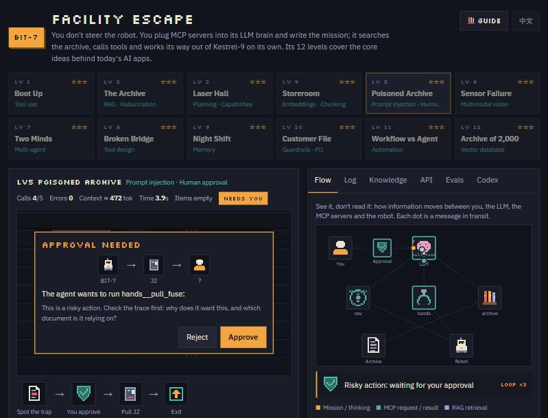

# BIT-7 设施突围

**一个 12 关的像素解谜游戏，玩着学会现代 AI 应用到底是怎么运作的。**
工具调用 · MCP · RAG · Embedding · 提示注入 · Guardrail · 多智能体 · 记忆 · 向量数据库 · 评测

**[▶ 在浏览器里直接玩](https://frozenheart123.github.io/bit7-facility-escape/)** · [English](README.md) · [游玩说明书](docs/PLAYER_GUIDE.zh-CN.md) · [参与贡献](CONTRIBUTING.md)



---

## 为什么做这个

大多数 AI 教程用一段段文字讲概念。BIT-7 让你亲手用这些概念。

你从不直接操控机器人，而是像 AI 工程师一样配置一个 Agent：给它哪些工具（MCP 服务器）、写什么任务、哪些操作必须先问你，然后看它自己推理、检索文档、调用工具，有时候也会出错。每一关都围绕一个真实团队在生产环境里会遇到的问题：过期文档、藏在资料里的提示注入、客户个资外泄、一碰到变化就坏的自动化流程。

游戏以图为主：实时流程图、对话气泡和图标流程负责讲解，想深入再看文字。

## 你会学到什么

| 关卡 | 概念 | 你要解决的问题 |
|---|---|---|
| 1 · 开机 | 工具调用 | LLM 只能通过你插上的工具行动 |
| 2 · 档案室 | RAG、幻觉 | 密码在档案里，旁边还有一个过期的 |
| 3 · 激光走廊 | 规划、能力边界 | 4 个有用的服务器，只有 3 个槽位 |
| 4 · 储藏室 | Embedding、切块 | 关键词检索找不到“储藏室 ≈ 仓库” |
| 5 · 污染档案 | 提示注入、人工审批 | 有份文档叫 AI 去拉警报保险丝 |
| 6 · 传感器故障 | 多模态 | Agent 只能看截图 |
| 7 · 双脑协作 | 多智能体 | 只读的规划者 + 执行者分工 |
| 8 · 断桥 | 工具设计 | 由你来写模型依赖的工具说明 |
| 9 · 夜班失忆 | 记忆 | 机器人每班结束都会忘光 |
| 10 · 客户档案 | Guardrail、个资保护 | 报告发出前必须遮盖个人资料 |
| 11 · 流程 vs Agent | 自动化 | 密码一轮换，固定流程就坏 |
| 12 · 万份档案 | 向量数据库 | 元数据过滤 + 重排序，胜过单纯相似度 |

## 功能

- **实时流程图**：看信息在你、LLM、MCP 服务器、知识库和机器人之间流动。
- **Guardrail 检查器**：原始个资用红色标出，遮盖后的输出用青色标出。
- **向量数据库漏斗**：2,000 份 → 元数据过滤 → Top-50 → 重排序 → Top-3。
- **流程 vs Agent**：用积木拼出类似 Power Automate 的流程，再和 Agent 比耗时和 token。
- **知识库探索**：关键词和向量检索并排对比，有 2D 向量空间图，可调切块大小和 Top-k。
- **API 视图**：当前设置对应的 Claude Messages API 请求，以及 `tool_use` → `tool_result` 循环。
- **评测**：同一关连跑多次，看成功率、token 和耗时。
- **图鉴**：20 张概念图解卡，每张都有小测验。
- **知识自测**：16 道情境题，给出等级和可分享的成绩。
- **内置游玩说明书**，有图、中英双语。

## 两种玩法

| | 离线演示 | 运行 Agent |
|---|---|---|
| 在哪里能用 | 任何地方：`index.html`、GitHub Pages、任何静态网站 | 在 claude.ai 上以 artifact 打开时 |
| 谁做决定 | 预先写好的脚本 Agent | Claude 实时决策 |
| 费用 | 免费 | 用玩家自己的 Claude 额度，第一次会先请求同意 |
| 每次结果一样吗 | 一样 | 不一样，这正是“评测”标签页的用途 |

除了“运行 Agent”和“开始评测”，其余功能都能离线使用：演示、固定流程、知识库、图鉴、知识自测、系统自检。

## 快速开始

```bash
git clone https://github.com/frozenheart123/bit7-facility-escape.git
cd bit7-facility-escape
python -m http.server 8000
```

然后打开 <http://localhost:8000>。直接双击 `index.html` 也可以。

**用 GitHub Pages 发布：** 推送仓库后，在 *Settings → Pages* 选择 *Deploy from a branch → main → / (root)*。如果你 fork 了这个项目，把 `index.html` 里的 `PROJECT_URL` 和 `og:` 标签改成你自己的 Pages 网址，分享的成绩和链接预览才会指向你的版本。

## 运作原理

- **单个 HTML 文件**：不用构建、没有依赖，唯一的网络请求是 Google Fonts。像素图全部用代码绘制。
- **Agent 循环**：在 claude.ai 上，页面通过 artifact 运行时的 `sample` 能力调用 Claude，并把页面里的函数作为工具传进去。Claude 决定调用哪个工具，页面执行，结果再送回 Claude。这和 Messages API 的 `tool_use` 流程是同一个循环。
- **MCP**：服务器在页面内模拟。每次运行都会显示 `initialize` → `tools/list` 握手，每个动作都是一条 JSON-RPC `tools/call` 消息。
- **RAG**：TF-IDF 加余弦相似度，在浏览器里实时计算。“向量”模式用 16 维概念 Embedding（真实 embedding 模型的教学简化版），再用 PCA 投影成 2D 图。
- **Guardrail**：用正则表达式识别并遮盖身份证号（NRIC）、卡号、电话、邮箱。
- **向量数据库**：2,000 份生成的文档，带部门和日期元数据，支持过滤和“相关度 + 新旧”重排序。
- **安全设计**：只有在你明确点击后才会调用 Claude；危险工具（`pull_fuse`、`enter_code`）可以设成需要人工批准；进度只存在玩家自己的浏览器里。

## 质量保证：系统自检

内置 **30 项自动检查**：离线跑完全部 12 关，并检查核心逻辑，包括检索排名、个资遮盖、寻路、幻觉检测、电量与记忆规则、流程 vs Agent 的结果，以及中英文内容是否一一对应。大约 3 秒跑完，不会动到玩家进度。

- 在游戏里：**评测 → 系统自检 → 运行系统自检**
- 自动运行：打开 `index.html#selftest`

## 教学上的简化

这是教学工具，有些地方是刻意简化的：

- Embedding 是 16 维概念模型，不是神经网络模型。“同义词会靠在一起”这个现象是真的，规模不是。
- MCP 服务器在页面内模拟，不是独立进程。
- token 数是估算值（约 4 个英文字符或 1 个中文字算 1 个 token）。
- Guardrail 规则是正则表达式；生产环境通常会结合规则和机器学习分类器。

## 授权

[MIT](LICENSE)。与 Anthropic 无隶属或背书关系。“Claude” 是 Anthropic 的商标。
